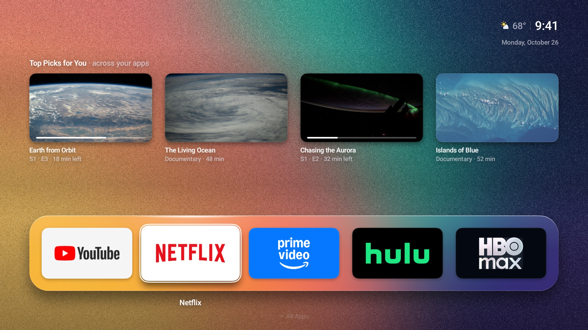
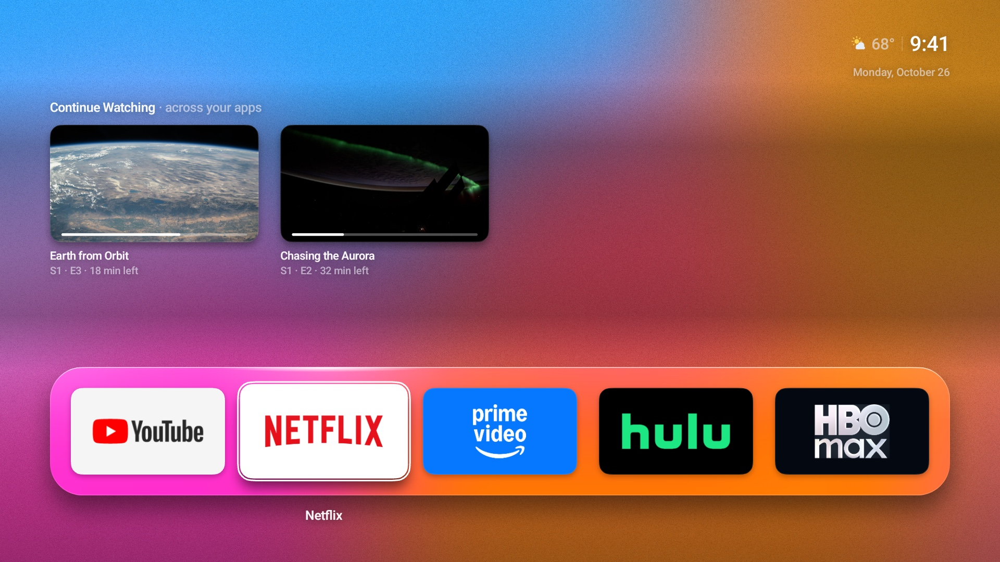
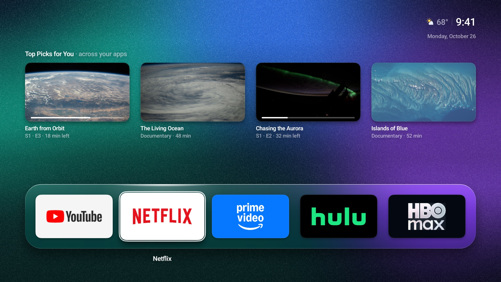
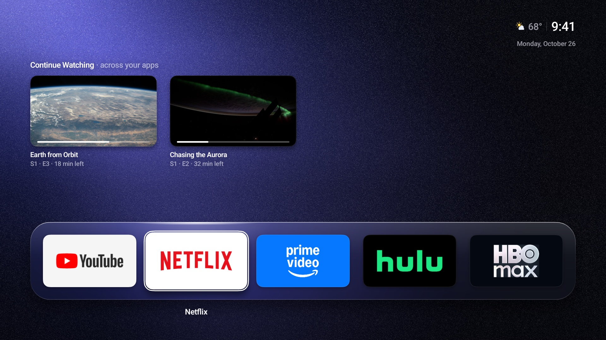

# Lumen

A clean, minimal home screen for **Android TV and Google TV**: your apps, recommendations, local weather and scenic NASA photos or grainy gradients. No ads or API key.


| | |
|---|---|
|  **Screensaver.** A NASA Earth photo with a large clock, the date and the weather. |  **Continue Watching.** Pick up where you left off, across your apps. |
|  **Your Top Shelf, your way.** Standard, Large or Compact cards. |  **All Apps.** Everything in one grid, in the order you choose. |
|  **Long-press OK** to move an app, hide it or take it off the top row. |  **Settings** drop down from the clock without leaving Home. |

### Backgrounds

Pick a scenic NASA Earth photo or one of ten grainy gradients: Horizon, Sorbet, Beam, Ember, Aurora, Dusk, Lagoon, Midnight, Citrus and Rose. With **Follow time of day** on, the gradient tints rose at dawn, amber at dusk and darker at night.

| | |
|---|---|
|  **Horizon** |  **Sorbet** |
|  **Aurora** |  **Midnight** |

## Put it on your TV

Works across brands running **Android TV or Google TV, Android 8 or newer**. It does not run directly on Samsung Tizen, LG webOS, Roku. Those TVs can use an external Android TV/Google TV device over HDMI.

1. **[Download the APK](https://github.com/yehudabortz/lumen/releases)** — you do not need to build the app.
2. **[Install it on your TV](docs/INSTALL.md)** using a phone, computer or USB drive.
3. Open Lumen. Set your weather city in **Settings → Location** and choose your background.
4. Select Lumen as your Home app if your TV allows it. The install guide covers locked firmware and switching back.

Want help through the whole process? **[Copy the AI setup prompt](docs/AI-SETUP.md).** It asks an assistant to adapt the steps to your TV and computer.

## Build it yourself

With Git, JDK 21 and the Android SDK installed:

```sh
git clone https://github.com/yehudabortz/lumen.git
cd lumen
./build.sh
```

The APK is `out/Lumen.apk`. **[Build setup for Mac, Linux and Windows](docs/BUILDING.md)** covers the prerequisites. No Gradle is used.

## Project

Lumen is experimental. Default Home, screensaver and recommendation support depend on your TV's firmware and installed apps. [Known limitations](CHANGELOG.md) · [Design](docs/design/DESIGN.md) · [Contributing](CONTRIBUTING.md)

[MIT License](LICENSE) · © 2026 Yehuda Bortz · [Third-party credits](NOTICE.md) · [Privacy](PRIVACY.md) · [Report a security issue](SECURITY.md)

The screenshots show the real Android UI in a clean emulator with public app artwork and sample recommendations. No personal TV data is included. [Capture workflow](tools/screenshots/README.md)
