# Lumen — design

A calm, clean and minimal home screen for Android TV and Google TV: your apps on a glass dock, what you're watching
from those apps, the time and the weather, over a landscape that follows the time of day. No ads, ever.

Status: **v0.3 implemented**, with cinematic mode, tile sizes and Inter still planned. The interactive mockup is [`mockup.html`](mockup.html): open it in
a browser. The arrow keys act as the D-pad, Enter as OK (hold it for the tile menu), Esc as Back and S opens settings.

## Principles

1. **Your content, never ads.** Everything on screen comes from apps installed on the TV: what you were watching
   and what those apps suggest. Lumen talks to no ad, analytics or recommendation server, and has none of its own.
2. **Calm, not empty.** A landscape, the time, your apps and one row of content. Nothing autoplays, nothing blinks.
3. **Remote first.** Everything works with the D-pad, OK and Back. Long-press OK is the only "advanced" gesture.
4. **The default must be great.** A new user should never need settings. Options exist to refine, not to fix.
5. **Light and boring to maintain.** One activity, plain Android views and Canvas, no libraries.

## Layout (reference: 1920×1080 px; the TV draws at 960×540 dp, so 1 dp = 2 px)

```
┌──────────────────────────────────────────────────────────────────────────────┐
│                                                         ☀ 63°  │  2:48       │  weather · clock
│                                                                              │
│   Top Picks for You · across your apps                                       │  Top Shelf heading
│   ┌──────────┐ ┌──────────┐ ┌──────────┐ ┌──────────┐                        │
│   │ artwork  │ │          │ │          │ │          │                        │  content cards
│   │ ▬▬▬▬──── │ │          │ │          │ │          │                        │  (progress bar)
│   └──────────┘ └──────────┘ └──────────┘ └──────────┘                        │
│   S2 · E4 · 22 min left                                                      │  progress
│     ╭────────────────────────────────────────────────────────────────╮       │
│     │ ┌──────┐ ┌──────┐ ┌──────┐ ┌──────┐ ┌──────┐                    │       │  glass dock (Top Row)
│     │ │      │ │FOCUS │ │      │ │      │ │      │                    │       │
│     │ └──────┘ └──────┘ └──────┘ └──────┘ └──────┘                    │       │
│     ╰────────────────────────────────────────────────────────────────╯       │
│                Northfilm                                                     │  focused favorite's name
└──────────────────────────────────────────────────────────────────────────────┘
```

| Element | Spec |
|---|---|
| Safe area | 96 px left/right, 64 px top/bottom (TV overscan); content aligns to x = 185 px |
| Clock | Top-right, its right edge (and the date's) on the dock's outer right edge, 40 px, Inter Medium, −2% tracking, tabular figures, 95% white. Optional date below, 21 px, 62% white |
| Weather | Left of the clock, separated by a 1.5 px hairline: a color glyph (34 px) and the temperature, 30 px Medium, 62% white |
| Top Shelf | Pinned to the top: heading at y = 190 px, just under the clock and date (it lifts only on screens too short to fit it above the dock): **Top Picks for You**, 25 px SemiBold, then “across your apps” in 62% white. Cards span the dock edge to edge, so the first card and the heading align with the dock's outer edge: Standard 4 across (400×225 px), Compact 5, Large 3; radius 22, gap 42, with the episode/time line set flush with the card's left edge |
| Dock | Glass (see Materials), full width between the 96 px overscan margins, bottom edge 128 px above the screen's real bottom edge (room for the focused app's name and the All Apps hint and credit row). Heights follow the TV's actual screen, not a fixed 1080, so the dock stays at the bottom on any aspect ratio; in All Apps it rises to 86 px from the top. Padding 40 px, tile gap 42 px, so five tiles fill it exactly. Tiles and cards use Apple's 60% corner smoothing; the dock (radius 62 = tile radius + padding) and the focus ring take whatever smoothing makes their corners begin exactly a padding further along the edge, so every outline runs parallel to the one inside it. Everything shares the dock's outer edges (96 and 1824 px): the shelf heading and cards, the All Apps heading and the All Apps hint start on the left one; the clock, date, photo credit and last card end on the right one, where the focused clock pill also ends. Top Shelf cards are clipped to the dock's width |
| Tiles | 16:9, radius 22 px. Medium 296×166.5 px (default, five across), Small 232×130 (six), Large 376×211 (four) |
| Focus | A crisp white 3 px focus ring, with a 2.5 px gap and no glow or dark edge on apps and recommendation cards, plus scale 1.09 (cards 1.07) over 240 ms, deep soft shadow and a low-contrast, static top-light sheen. Focused tiles and cards add a softly eased 0.4% double-beat pulse every 3.4 s; it starts only after D-pad navigation. Home restores stable focus by app/content identity at rest, without a zoom replay or entry pulse. Focus springs are critically damped. Reduced motion and open menus pause it. The dock's specular highlight slides to sit above the focused tile |
| Label | Focused tile only (default). 25 px SemiBold, 22 px under the dock |
| Legibility | A dark vignette behind the clock and along the bottom, plus a soft band behind the shelf that strengthens on bright daytime scenes. During the All Apps scroll, the clock, weather and date lift up and fade out (fade only with Reduced motion); nothing is laid over the dock |

## Screens

1. **Home.** Scene, weather and clock, the Top Shelf, the dock. Focus starts on the dock.
2. **Top Shelf.** **Top Picks for You** mixes in-progress Watch Next items with recommendations from opted-in apps'
   preview channels. In-progress items come first, then suggestions and additional Watch Next items are interleaved
   across sources. Progress bars show where to resume. **Continue Watching** mode shows Watch Next
   items across apps. Hidden apps and apps switched off in *Apps in Top Shelf* are excluded.
3. **Cinematic.** Up from the dock moves focus into the shelf. The focused item's artwork fills the screen behind a
   dark gradient, with the app name, the title, year · rating · genre, a two-line synopsis and *Resume*/*Play*.
   The dock slides away and the cards settle at the bottom. Back or Down returns home.
4. **All Apps.** Down from the dock: the shelf fades, the page scrolls up, and the dock rises to the top with
   nothing laid over it while the clock and weather lift away. The background blurs (64 px), saturates and dims
   to half, and a five-column grid aligned with the dock's tiles appears. Back returns to the dock; Back again
   starts the screensaver.
5. **Tile menu.** Long-press OK on a tile: *Move* · *Add to/Remove from Top Row* · *Show in Top Shelf* · *Hide* ·
   *App info* · *Home Screen Settings*. *Move* makes the tile wiggle; Left/Right moves it, OK drops it. In All Apps,
   Up/Down also move it a row and the tiles between shift along; the grid stays A–Z until first rearranged.
6. **Status bar and settings.** Up from the shelf (or the dock) focuses the weather and clock: they sit in a quiet
   glass bar and a gear chip slides in at its end. The chip is the focused control (near-white, lifted, dark gear).
   OK opens Settings as a compact dropdown 12 px below the bar, right edges aligned, as tall as its content, with
   today's weather (a condition glyph, the temperature, high and low) under the title. Changes preview live. There is no settings tile; the tile
   menu and the remote's Menu key open the same dropdown.
7. **Screensaver.** The same scene, full screen, drifting very slowly (a 90 s zoom-and-pan, back and forth), with
   a large clock (150 px SemiBold), the date and the weather at the top right, where Home's clock sits. The text
   block moves to the next corner every four minutes so nothing burns into OLED panels, fading out and in over
   600 ms. It fades in with the first picture over 450 ms; new photos crossfade over 2.5 s.
   Any key wakes the TV straight back to Home.

## Content: where the shelf comes from

Android TV has a standard place where apps publish what you're watching and what they suggest: the **TV provider**
(`TvContract`). Apps write *Watch Next* items ("continue watching", "next episode", "watchlist") and *preview
channels* (their own recommendation rows). Lumen only reads that data. It never adds its own picks and has no
server.

- **Access.** With `READ_TV_LISTINGS` (a permission the user grants once from a prompt), a launcher can read every
  app's Watch Next items and preview programs marked searchable, which is the default. Without it Android shows only
  the launcher's own rows. Confirmed in the provider's source (`TvProvider.createSqlParams`).
- **Top Picks order:** in-progress Watch Next items (newest engagement first), then recommendations interleaved
  across app sources, then other Watch Next items. **Continue Watching** mode uses only Watch Next records across all enabled apps.
- **Opening an item** fires the program's intent URI, so it lands on that title inside its app.
- **Per app:** every app can be turned off in *Apps in Top Shelf* or from its tile menu. Apps the user hid, or that
  are disabled, never appear.
- **Artwork** comes from the poster/thumbnail URIs the apps provide. They are fetched, decoded at card size and
  cached on disk (a few MB at most).
- **An honest limit:** on Google TV some apps send "continue watching" only to Google's servers and not to the
  on-device provider. Those apps simply have an empty shelf, and Up Next covers for them.

## Weather

- **Source:** [Open-Meteo](https://open-meteo.com): free, no key, no account. One request every 30 minutes while
  the TV is on (current temperature and condition, plus today's high and low for the screensaver).
- **Location:** Settings → Clock & Weather → Location opens a city/postal-code search using Open-Meteo's
  [geocoding API](https://open-meteo.com/en/docs/geocoding-api) (GeoNames data). A native TV keyboard accepts the
  query, then a D-pad list shows matching cities with region and country; the user explicitly picks one. Search
  runs only on submission. Empty results and network failures leave the previous city unchanged and allow retry.
  The city and coordinates are stored only in private on-device preferences, shared by Home and the screensaver.
  No location permission is needed. Until a city is set, **Time zone (approx.)** picks a main city for the TV's
  time zone; this is an approximation, not device geolocation. **Use time zone** restores that fallback.
- **Refresh:** selecting a city or changing units immediately clears the old reading and fetches again. Late
  responses from an older city/unit choice are ignored. Home and the screensaver check every 30 seconds, with
  successful forecasts reused for 30 minutes and failed requests retried after five minutes.
- **Units:** follow the TV's region (°F in the US), or choose.
- **Offline:** the weather simply disappears; nothing shows an error.

## NASA photos (no key)

Background and screensaver can use **NASA photos** from the public
[NASA Image and Video Library](https://images.nasa.gov) search and asset APIs. No account, API key or new
permission is needed. At each rotation Lumen searches live Earth and nature topics, filters out concept art,
diagrams, simulations, and people-focused catalog entries, then fetches a returned image's available JPEG
rendition. It does not ship a predefined NASA image list. Title and photographer or NASA center
are read from that result's metadata and shown on screen. See [NASA photo behavior](../NASA-PHOTOS.md).

- **Home:** rotates hourly or daily using **New photo**. NASA is an appearance option; NASA is the fresh-install default; existing background choices are preserved.
- **Screensaver:** NASA photos are the default for new preferences, rotating every five minutes. Existing explicit
  screensaver choices are preserved. Both views share the compressed disk cache, with separate rotation positions
  persisted across restarts. Each picture shows its title and creator credit.
- **Cache:** at most six JPEGs, 2 MiB each and 1920 × 1280, in private app cache storage (12 MiB plus one
  2 MiB temporary file). A single background-priority worker makes a bounded search and image request only when
  rotation is due. It atomically stores validated renditions. Failed requests retry after
  15 minutes; the last good image stays visible offline.
- **Startup/offline:** disk decoding and downloads never run on the UI thread. A drawn landscape appears immediately
  on a cold cache, then the first downloaded photo replaces it. With cached photos, rotation works offline. Android
  may evict the cache under storage pressure; it is rebuilt on later use.
- **Memory/rendering:** image inputs are limited to 1920 × 1280; displayed backdrops are capped at 1920 pixels wide.
  Bounds are checked before decode and smaller displays use sampled decoding. Home holds one photo and two small
  blurred copies, with no added per-frame work. The dream holds at most two display bitmaps for a crossfade. Slow
  drift redraws at about 30 fps; Reduced motion stops drift and redraws once a second outside fades. Clock/date
  strings are formatted only when the minute or weather changes.

## Scenes (backgrounds)

Landscapes drawn in code, so they cost no image files and no downloads and stay sharp at any resolution:

| Scene | What's in it |
|---|---|
| **Alpine** (default) | Four mountain ranges fading into haze, a pine shore, a lake with a soft reflection and a sun or moon glint, pines framing the edges |
| **Forest** | Six tree-covered ridges with mist between them |
| **Dunes** | Smooth layered dunes with a low sun |
| **Coast** | A fjord: headlands dropping into a sea lit at the horizon |
| **Graphite** / **Black** | Plain, for the quietest setup (Black is OLED-friendly) |

Each scene is lit by one of four palettes: **dawn**, **day**, **dusk**, **night** (stars and a crescent moon). With
*Follow time of day* on, the palette changes with the clock, crossfading over a few minutes. Far ranges take on the
horizon's color (atmospheric perspective); a 2% grain stops gradients from banding. The same scene generator makes
the placeholder artwork in the mockup.

## Geometry: corners and spacing

Every rounded shape uses a **continuous corner** (the curvature eases in over 1.53 × the radius instead of
jumping from straight to circular; see `Ui.squircle`). Capsules and circles keep true round ends.

Radii are **concentric**: an inner radius is the outer radius minus the padding between them.

| Container | Radius | Padding | Inner element | Inner radius |
|---|---|---|---|---|
| Dock | 42 | 22 | App tile | 20 |
| Status bar (64 tall) | 32 | 6 | Gear chip (52) | 26 |
| Settings dropdown, tile menu | 32 | 16 | Selection row (60 tall) | 16 |

Spacing sits on an 8-pt grid, with shared insets so edges line up: text sits 24 inside any bar or selection row, so
a menu's title, weather line, section headings, row labels and values all align 40 from its edges; a section heading
has 24 above and 8 below; the status bar and dropdown share the 96 px safe margin.

## Typography

Typography uses a system sans-serif; Inter is the planned alternative.

| Use | Size | Weight | Tracking |
|---|---|---|---|
| Screensaver clock | 150 px | SemiBold | −4.5%, tabular figures |
| Cinematic title | 76 px | Bold | −3.5% |
| Panel title ("Home Screen") | 40 px | Bold | −3% |
| Clock | 40 px | Medium | −2%, tabular figures |
| Headings, menu names | 25–29 px | SemiBold | −2% |
| Rows, labels | 25 px | Medium / SemiBold | −1% |
| Secondary text | 19–23 px | Medium | 0, 62% or 40% white |

## Materials

One glass recipe, used by the dock, the tile menu, the settings panel and the Move hint:

| Layer | Recipe |
|---|---|
| Backdrop | Background blurred ~40 px (menus: 60 px), saturation ×1.45 (menus ×1.9, slightly darkened) |
| Tint | Dock: white 8.5% at the top fading to 2%. Menus: a dark charcoal tint (~65%) so text stays crisp |
| Specular rim | 1.5 px edge: bright white (≈78%) along the top, fading to 4% down the sides, a faint 20% bounce at the bottom |
| Sheen | White 7% → 0% across the upper 40% |
| Moving highlight | On the dock: a narrow bright line on the rim plus a soft glow beneath it, centered on the focused tile, gliding 320 ms |
| Shadow | 0 44 px 90 px (−24 px spread), 60% black, plus a tight contact shadow |
| Depth of field | When a menu or settings opens, the home screen behind softens (12 px blur) and dims 26% |

Selected rows in menus are near-white pills (94%) with dark text, as on a clean interface.

## Options (the whole list, on purpose)

| Section | Option | Choices | Default |
|---|---|---|---|
| Appearance | Background | Alpine, Forest, Dunes, Coast, NASA photos, Graphite, Black | **NASA photos** |
| | New photo | Every hour / Every day (only with photos) | **Every hour** |
| | Follow time of day | On / Off | **On** |
| | Motion | Full / Reduced (fades only; focus shown with an outline) | **Full** |
| Top Shelf | Top Shelf | Top Picks for You / Continue Watching / Off | **Top Picks for You** |
| | Cinematic artwork | On / Off (Off keeps the scene behind the hero text) | **On** |
| | Card size | Standard (376×211) / Large (520×293, shelf lifts to clear the dock) / Compact (300×169) | **Standard** |
| | Card text | Title & details / Title only / None | **Title & details** |
| | Apps in Top Shelf | Per-app toggles | all |
| Top Row | Tile size | Small / Medium / Large | **Medium** |
| | Labels | On focus / Always / Never | **On focus** |
| | Apps | Edit order (opens Move) | well-known video apps first, then A–Z, five apps |
| Clock & Weather | Clock | System (12/24 h) / 12-hour / 24-hour / Off | **System** |
| | Show date | On / Off | **Off** |
| | Weather | On / Off | **On** |
| | Location | City/postal-code search / Time zone (approx.) | **Time zone (approx.)** |
| | Units | Auto / °F / °C | **Auto** |
| Screensaver | Screensaver | NASA photos / Landscape / Black | **NASA photos** |
| Apps | Hidden apps | List with toggles | none |
| About | Version and creator credit (Yehuda Bortz), how to switch back to the original home screen | | |

## Technical shape (keeps it light)

- **Java, no Gradle, no AndroidX, no third-party libraries.** `build.sh` runs aapt2 → javac → d8 → zipalign →
  apksigner. Target APK size: under 400 KB; no font assets or third-party libraries are currently bundled.
  Needs build-tools 35: d8 8.2 (build-tools 34) crashes on a file that has both an anonymous class and a lambda.
- **minSdk 26 (Android 8), targetSdk 34** (current target, so Play Protect accepts the install).
- **Components:** one activity (`HOME` + `LEANBACK_LAUNCHER`) and one `DreamService` (the screensaver).
  Classes: `HomeActivity`, `AppStore` (apps, installs/removals), `ShelfStore` (TV provider queries, change
  observer), `ArtCache`, `Weather`, `Scene` (the landscape generator), `Glass`, `TileView`, `CardView`, `TileMenu`,
  `SettingsPanel`, `Screensaver`, `Prefs`.
- **Permissions, and why:** `INTERNET` (artwork the apps point to, and the weather), `READ_TV_LISTINGS` (the shelf;
  asked once, and the shelf simply hides if declined). Nothing else: no location, no storage, no accessibility
  service, no boot receiver, no analytics.
- **Glass without live blur.** Lumen draws the scene itself, so it renders a blurred copy once (when the scene or
  the time-of-day palette changes) and the dock samples it. Cinematic backdrops are blurred once per item. Menus
  blur a single snapshot taken as they open. Nothing is blurred per frame. Android 12+ uses `RenderEffect`; older
  versions use a small box blur on a downscaled copy.
- **The screensaver** is a standard Android `DreamService`. Google TV hides third-party screensavers in its own
  settings, so setup sets it once with `settings put secure screensaver_components` (documented in the README).
  Back or another remote key exits the screensaver and returns to Home.
- **Memory target:** under 60 MB idle on Home. Artwork is decoded at card size; only the visible shelf is in memory.
  Measured on a 2022 Sony BRAVIA (3 GB RAM, Android 12), v0.2: 54 MB PSS with a shelf of artwork loaded; median
  frame 12 ms (60 fps), 0.4% of frames over deadline while navigating. Shadows are nine-slice bitmaps (one per
  corner size, never regenerated while animating); motion uses damped springs. The backdrop and its legibility gradients are composited once per
  scene, and the glass dock is a single bitmap-shaded rounded rect, so a frame is one full-screen bitmap plus the UI.
  NASA check (23 October 2026, same TV, paced dock navigation after a clean cached restart): 52,670 KB PSS versus
  52,560 KB with the drawn background; median frame 20 ms versus 19 ms. Samples were about 250 frames each,
  with three versus one missed deadlines; these short runs are indicative, not a long-duration benchmark.
  The earlier fixed collection totaled 1,165,531 bytes. Live search now keeps a rolling cache capped at six
  renditions, each at most 2 MiB. After live search was installed, one TV reading was 81,002 KB PSS with the
  screensaver active and 72,018 KB after Home returned to foreground. These point samples include both activities
  and are not a controlled comparison with the earlier clean-restart Home measurement.
- **Nothing personal in the repo.** Device addresses, credentials and personal TV screenshots stay out of tracked
  source. Gallery captures use a clean emulator and public sample content. Signing keys and machine-specific
  settings remain git-ignored in `*.keystore` and `local.properties`.

## Gallery (native Android captures with sample content)

These are 1920 × 1080 captures of the production Android views running in a clean Google TV emulator.
App tiles use public publisher artwork; recommendation titles and progress are fictional examples illustrated
with NASA Earth imagery. The samples do not represent a streaming service's actual catalog or a user's history.
The screensaver image captures its production view, independently of the emulator's DreamService policy.
See the [capture workflow and artwork sources](../../tools/screenshots/README.md). The HTML mockup remains
an interactive design reference; planned cinematic mode is not shown as a shipped screen.

| | |
|---|---|
| 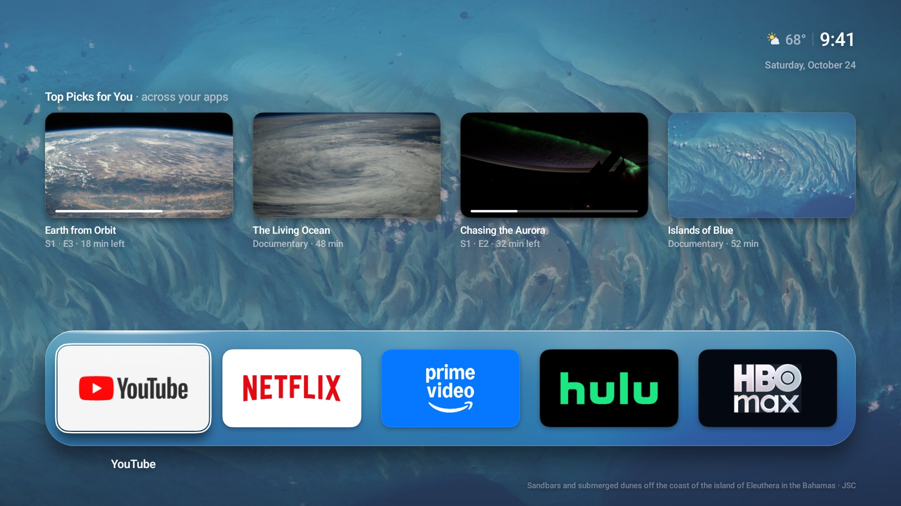 Home: NASA wallpaper and mixed sample Top Picks | 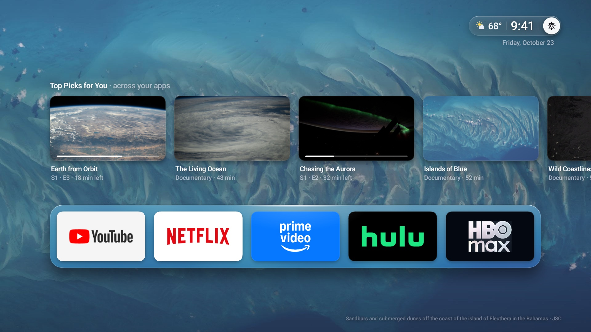 Status bar focused: the gear chip |
| 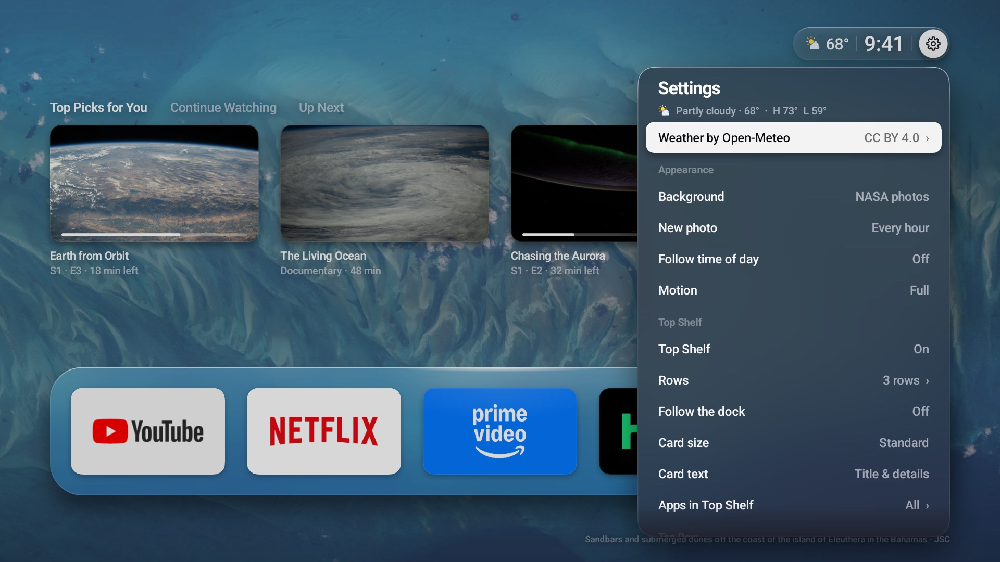 Settings dropdown from the status bar | 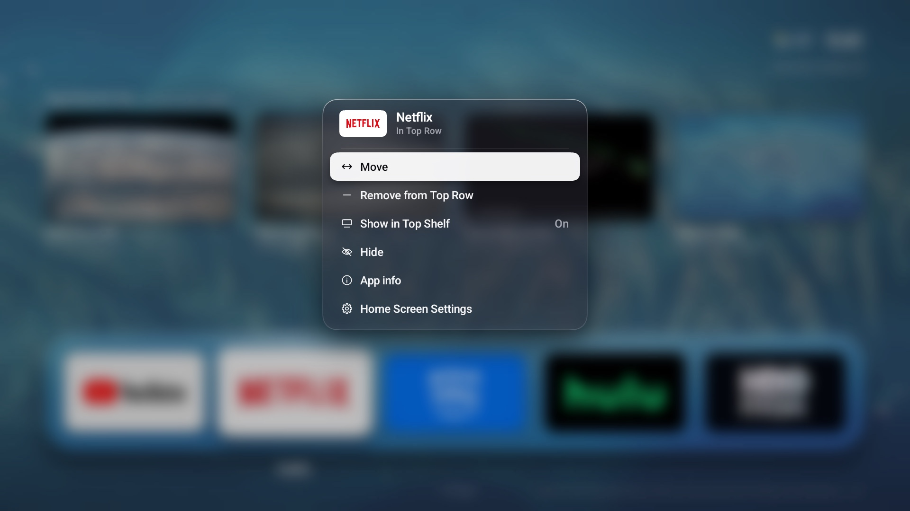 Tile menu (long-press OK) |
| 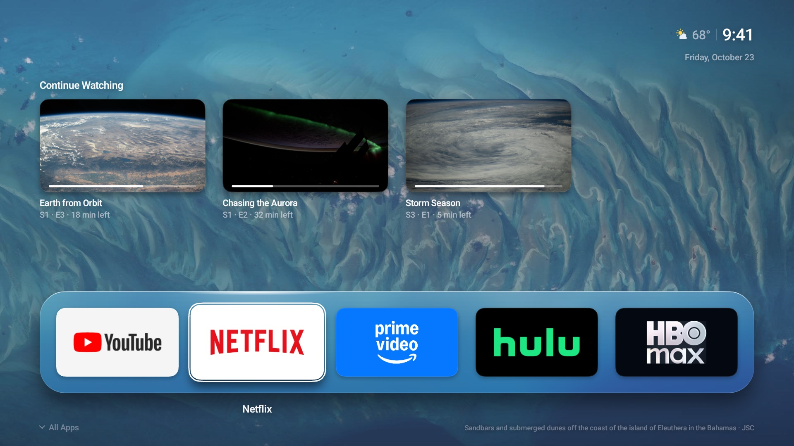 Continue Watching across sample apps | 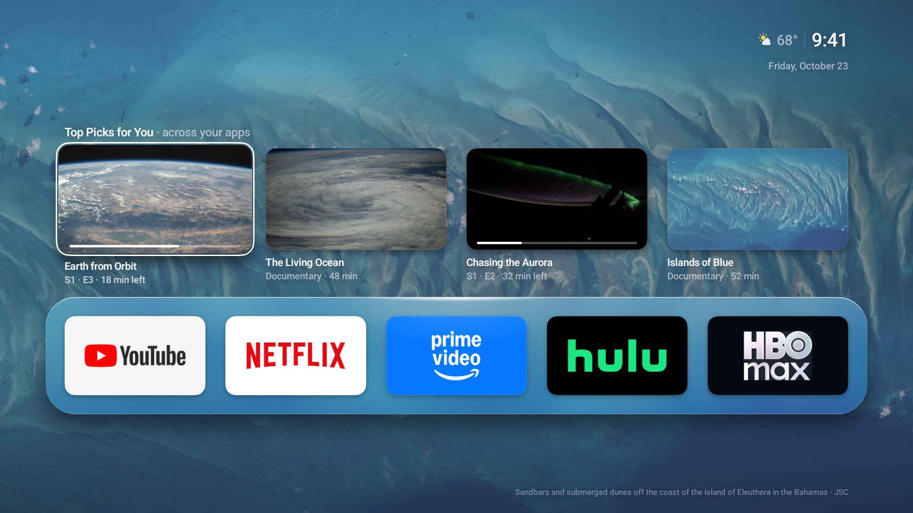 Focus in Top Picks |
| 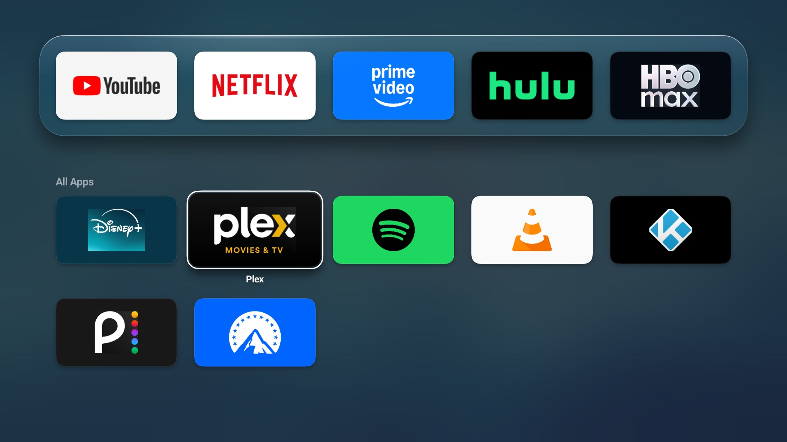 All Apps | 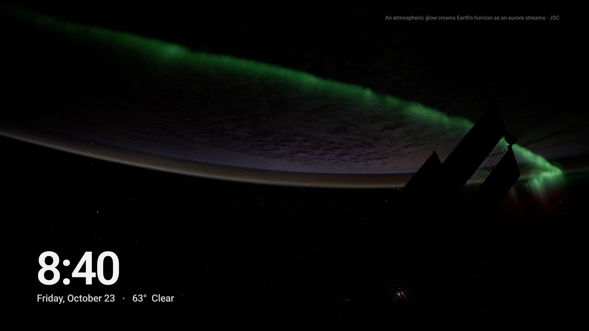 Screensaver with a sample NASA Earth photo |
| 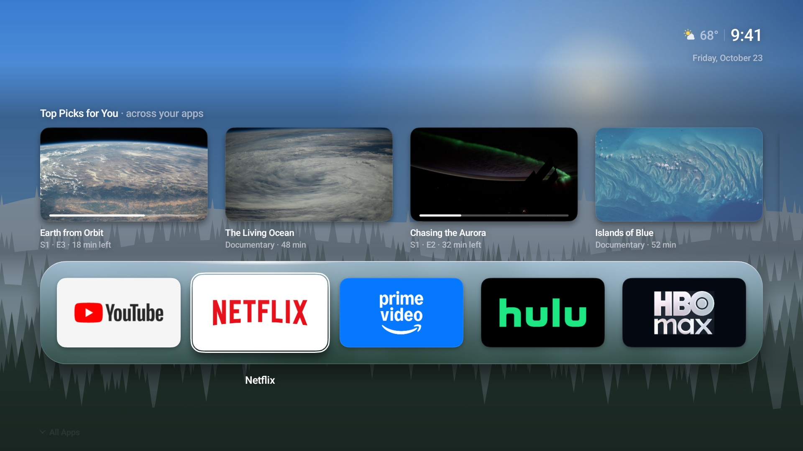 Forest by day | 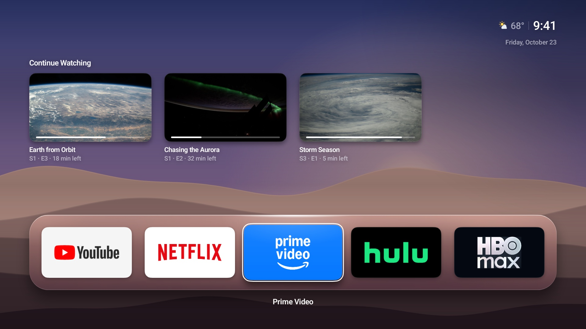 Dunes at dawn, Up Next |
| 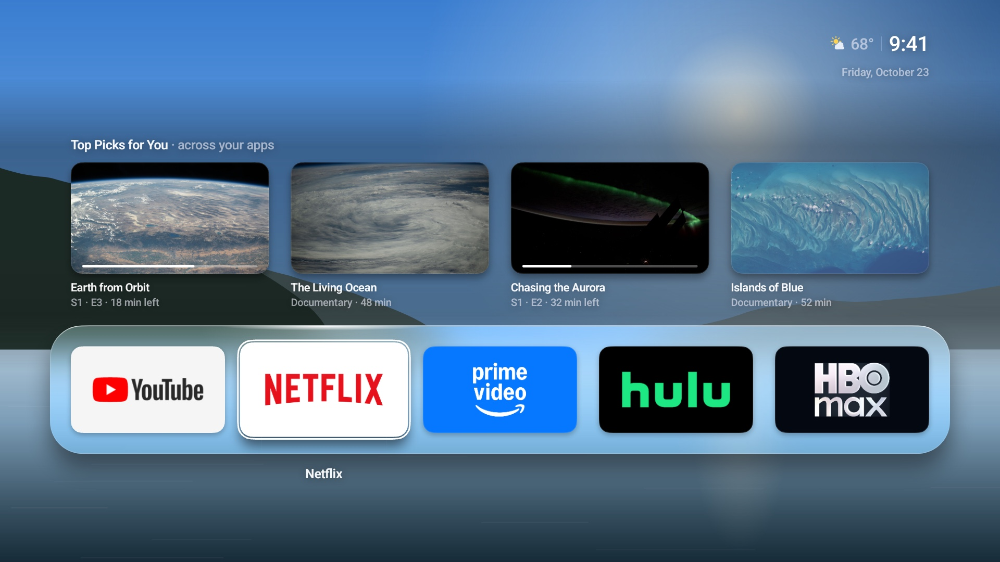 Coast by day | 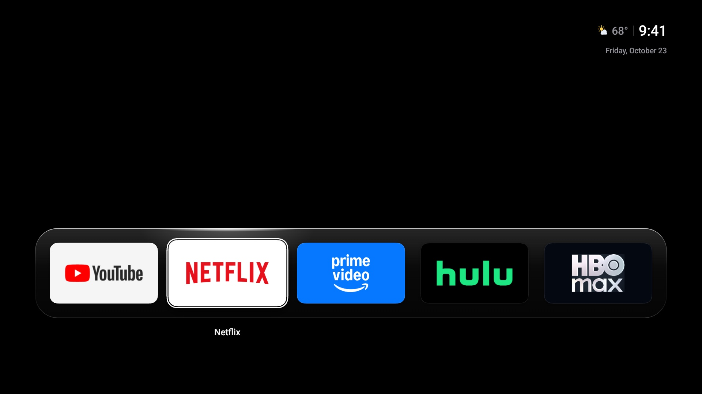 Quiet: Black, Top Shelf off |
| 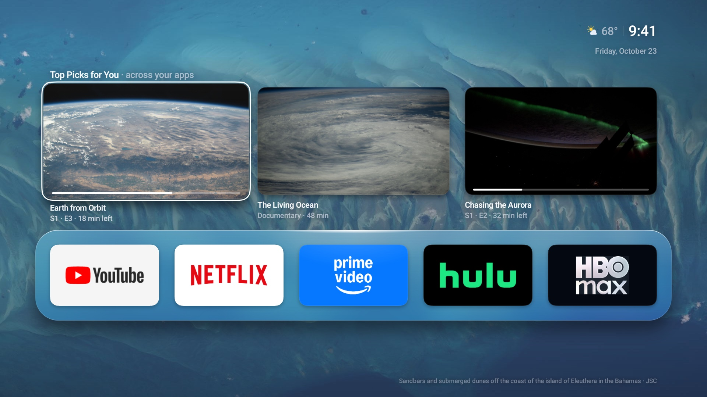 Top Shelf with Large cards | 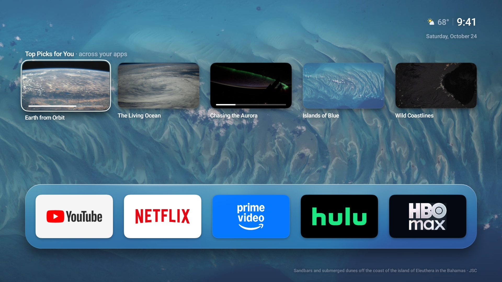 Compact cards, title only |

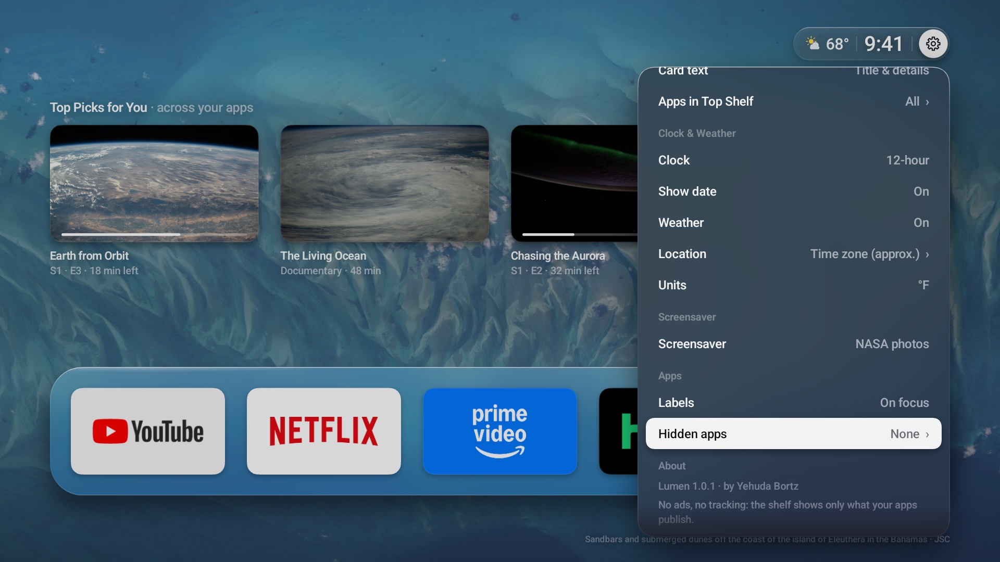 About: creator credit and a wrapped privacy note inside the panel.

Weather attribution is a focusable source row next to the forecast in Settings, opening Open-Meteo, GeoNames and license links. The release has no Unsplash integration or embedded API keys. See [notices](../../NOTICE.md) and [privacy](../../PRIVACY.md).

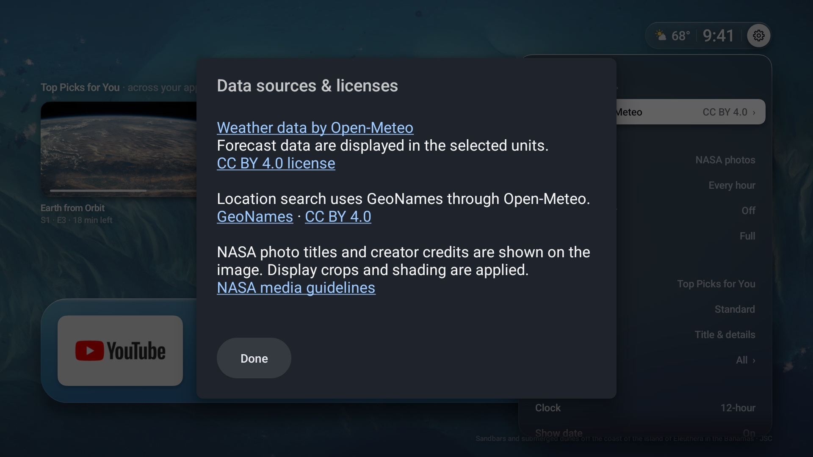 Weather and location attribution with accessible source/license links.
